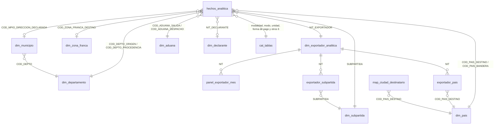
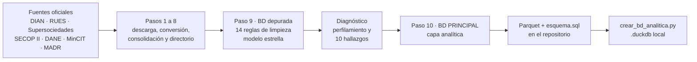

# BD principal del proyecto: `BD_exportaciones_Colombia_analitica`

> **Esta es la base de datos con la que se trabaja.** Todo análisis, consulta, cuaderno o tablero del proyecto parte de ella. Reúne en un solo archivo DuckDB las exportaciones de Colombia de enero de 2024 a septiembre de 2026, ya depuradas, con llaves, catálogos completos, banderas de calidad, magnitudes corregidas, panel por empresa y vistas listas para usar.
>
> ```bash
> pip install -r requirements.txt
> python crear_bd_analitica.py     # ~30 s → datos/limpios/bd_analitica/BD_exportaciones_Colombia_analitica.duckdb
> ```
>
> Empieza por la vista **`vw_exportaciones`**.

La BD depurada del paso 9 (`datos/limpios/bd_depurada/`) es su insumo y se conserva sin cambios. Los archivos de los pasos 7 y 8 son historia del proceso. Si una cifra de la BD principal no coincide con otra fuente del repositorio, manda la BD principal.

## Contenido

1. [Cifras de control](#1-cifras-de-control)
2. [Cómo obtenerla y abrirla](#2-cómo-obtenerla-y-abrirla)
3. [Qué contiene](#3-qué-contiene)
4. [Cómo se organizó la base: el proceso completo](#4-cómo-se-organizó-la-base-el-proceso-completo)
5. [Técnicas y metodologías de depuración](#5-técnicas-y-metodologías-de-depuración)
6. [Reglas de la capa analítica y su impacto](#6-reglas-de-la-capa-analítica-y-su-impacto)
7. [Decisiones sobre los 10 hallazgos del diagnóstico](#7-decisiones-sobre-los-10-hallazgos-del-diagnóstico)
8. [Cambios de razón social y traslados de domicilio](#8-cambios-de-razón-social-y-traslados-de-domicilio)
9. [Validación](#9-validación)
10. [Limitaciones](#10-limitaciones)
11. [Cómo regenerarla](#11-cómo-regenerarla)

## 1. Cifras de control

| Cifra | Valor |
|---|---|
| Líneas de declaración (tabla `hechos_analitica`) | **3.613.237**, iguales a la BD depurada |
| FOB total | **USD 142.059,8 M**, igual a la BD depurada |
| FOB por año frente al DANE | 2024: 49.556,5 frente a 49.552,0 (0,009 %) · 2025: 50.201,5 frente a 50.199,9 (0,003 %) · ene-sep 2026: 42.301,8 frente a 42.301,8 (0,000 %) |
| Empresas en el directorio | 13.305, de ellas 3.195 exportadores antioqueños (A o B) |
| Líneas con precio atípico (`FLAG_ATIPICO`) | 113.790 (USD 997,7 M, 0,70 % del FOB) |
| Pesos y cantidades reconstruidos | 5.742 pesos y 6.534 cantidades; el FOB no se modifica |
| Llaves | 31 primarias y 9 foráneas declaradas; 21 relaciones de la tabla de hechos validadas con 0 huérfanos |
| Objetos | 32 tablas y 11 vistas; 233 entradas en el diccionario |

Las consultas que devuelven estas cifras están en [consultas/07_bd_principal.sql](../consultas/07_bd_principal.sql).

## 2. Cómo obtenerla y abrirla

El archivo `.duckdb` pesa unos 375 MB. GitHub no acepta archivos de más de 100 MB, así que el repositorio guarda la base **por partes, en parquet**, y el script `crear_bd_analitica.py` la arma:

| Parte | Dónde está | Por qué así |
|---|---|---|
| Hechos de la depurada (un parquet por mes) | `datos/limpios/bd_depurada/hechos_exportaciones/` | Ya estaban versionados: la capa no los repite |
| Columnas nuevas de los hechos, por `ID_REGISTRO` | `datos/limpios/bd_analitica/hechos_analitica_complemento.parquet` (28 MB) | Solo lo que agrega la capa |
| Demás tablas | `datos/limpios/bd_analitica/<tabla>.parquet` | Una por tabla |
| Llaves y vistas | `datos/limpios/bd_analitica/esquema.sql` | El script recrea la estructura exacta |

```python
import duckdb
con = duckdb.connect("datos/limpios/bd_analitica/BD_exportaciones_Colombia_analitica.duckdb", read_only=True)

# Diez principales destinos de los exportadores antioqueños en 2025, solo ventas al exterior
con.sql("""SELECT PAIS_DESTINO, round(sum(VALOR_FOB_USD) / 1e6, 1) AS fob_musd
           FROM vw_ventas_exterior
           WHERE ES_EXPORTADOR_ANTIOQUENO AND ANIO = 2025
           GROUP BY 1 ORDER BY 2 DESC LIMIT 10""").show()

panel = con.sql("SELECT * FROM panel_exportador_mes").df()   # una fila por empresa y mes con exportaciones
```

También abre en DBeaver (conexión DuckDB) o en cualquier cliente con DuckDB 1.0 o posterior. Conviene tener unos 4 GB de RAM libres para armarla.

## 3. Qué contiene



| Grupo | Objeto | Qué es | Filas |
|---|---|---|---|
| **Vistas para empezar** | `vw_exportaciones` | **Punto de partida:** hechos con nombres, atributos del producto y de la empresa, descripciones de catálogos, magnitudes de análisis y precios unitarios. 118 columnas | 3.613.237 |
| | `vw_ventas_exterior` | Solo lo que sale del país (sin zonas francas colombianas) | 3.546.110 |
| | `vw_exportaciones_origen_asignado` | Sin el origen "00 Departamentos varios", para análisis por departamento | 3.611.986 |
| | `vw_exportaciones_antioquia`, `vw_directorio_antioquia` | Mercancía o empresas de Antioquia | 1.034.865 y 3.195 |
| | `vw_serie_mensual` | FOB y número de exportadores por mes | 33 |
| Hechos | `hechos_analitica` | Una fila por ítem de declaración DIAN: 59 columnas de la depurada y 12 de la capa (banderas y ajustes) | 3.613.237 |
| Dimensiones | `dim_exportador_analitica` | Directorio por NIT: RUES, Supersociedades en pesos constantes, SECOP II, vínculo con Antioquia, historia de nombre y domicilio. 81 columnas | 13.305 |
| | `dim_subpartida`, `dim_pais`, `dim_zona_franca`, `dim_departamento`, `dim_municipio`, `dim_aduana`, `dim_declarante` | Producto, territorio, aduana y agencia | 5.881 · 215 · 31 · 34 · 93 · 22 · 717 |
| Catálogos | 10 tablas `cat_*` y la vista `catalogo_codigos` | Descripción de cada código con su fuente y nivel de confianza | 84 códigos |
| Agregados | `panel_exportador_mes` | Empresa × mes: FOB total, al exterior, no minero-energético, de origen Antioquia, kilos y líneas atípicas | 128.909 |
| | `exportador_pais`, `exportador_subpartida` | Empresa × destino y empresa × producto, con su peso dentro de la empresa y ranking | 46.148 y 115.650 |
| | `map_ciudad_destinatario` | Ciudad del comprador tal como viene y normalizada | 21.460 |
| Referencias oficiales | `ref_dane_publicaciones`, `ref_mincit_trimestral`, `ref_madr_agricola_anual` | Cifras publicadas para el cuadre, con su enlace | 4 · 10 · 3 |
| Validación | `vw_validacion_dane`, `vw_validacion_mincit`, `vw_validacion_madr`, `vw_ciudad_comprador_por_completar` | Cuadre contra las cifras oficiales y NIT por completar | — |
| Trazabilidad | `log_preparacion`, `log_depuracion`, `relaciones_llaves`, `diccionario_datos`, `info_capa`, `info_bd_depurada` | Cada regla con filas y FOB afectados, cada llave, cada columna y la ficha de la base | — |

Qué usar según la pregunta:

| Para… | Usa |
|---|---|
| Ventas al exterior | `vw_ventas_exterior` |
| Análisis por departamento de origen | `vw_exportaciones_origen_asignado` |
| Volúmenes y precios | Columnas `*_ANALISIS` de `vw_exportaciones`; para máxima limpieza, `WHERE NOT FLAG_ATIPICO` |
| Valor por línea con máxima limpieza | Además, `WHERE NOT FLAG_POSIBLE_ERROR_FOB` |
| Empresas en el tiempo (permanencia, entradas y salidas) | `panel_exportador_mes` (completar con 0 los meses sin exportaciones) |
| Diversificación de destinos y productos | `exportador_pais`, `exportador_subpartida` |
| Tamaño o intensidad exportadora de la empresa | `SS_*_DIC2025` y `SS_INTENSIDAD_EXPORTADORA_PCT` de `dim_exportador_analitica` |

Cada columna está descrita en [diccionario_bd_analitica.md](diccionario_bd_analitica.md) (también en CSV y dentro de la base, en `diccionario_datos`).

## 4. Cómo se organizó la base: el proceso completo



### Etapa 1 · Recolección y consolidación (pasos 1 a 8)

Se descargaron las 33 bases mensuales de exportaciones de la DIAN (enero de 2024 a septiembre de 2026), el RUES, Supersociedades, SECOP II, DIVIPOLA y las series de MinCIT y MinAgricultura. Se convirtieron a parquet, se unieron en una sola tabla, se consultó cada NIT en el RUES y en SECOP II y se armó el directorio de empresas con su vínculo con Antioquia. Detalle: [pipeline.md](pipeline.md) y [metodologia.md](metodologia.md).

### Etapa 2 · Depuración (paso 9 → BD depurada)

Se convirtió todo en un modelo estrella con una sola tabla de hechos y se aplicaron 14 reglas de limpieza, cada una registrada con las filas y el FOB que afectó. Las principales:

- **Identidad:** persona natural definida por la ausencia de NIT (no por la razón social), y las 107.212 líneas de septiembre de 2024 con razón social enmascarada atribuidas a su empresa.
- **Homologación:** países y banderas a ISO 3166 alfa-3 (la DIAN cambió de esquema en 2025); zonas francas colombianas con código propio `XCF`; departamentos y municipios a DIVIPOLA; códigos con ceros a la izquierda unificados.
- **Validez:** ceros que significan "no aplica" a nulo, fechas de texto a tipo fecha, errores de digitación y entidades HTML corregidos.
- **Redundancia:** de 99 a 61 columnas en la tabla de hechos; Antioquia como vista y no como copia.
- **Unicidad:** una razón social canónica por NIT.
- **Privacidad:** fuera el nombre y el domicilio del comprador en el exterior.

El detalle completo, con impacto por regla, está en [limpieza_bd_depurada.md](limpieza_bd_depurada.md).

### Etapa 3 · Diagnóstico de la BD depurada (comprensión de los datos)

Antes de analizar se hizo un perfilamiento completo de la depurada:

- composición: tablas, columnas, tipos y filas;
- completitud de cada columna;
- cardinalidad y unicidad de las llaves;
- integridad referencial;
- dominios de los códigos frente a los catálogos;
- distribuciones de precio por kilo y por unidad;
- coherencia de los textos;
- cuadre contra las cifras oficiales.

Conclusión: **la depurada ya se podía analizar** (cero huérfanos, totales iguales a MinCIT), pero quedaban 10 puntos que podían sesgar análisis de volumen, de precio, de empresa o regionales (sección 7).

### Etapa 4 · Capa analítica (paso 10 → BD principal)

`pipeline/p10_capa_analitica.py` abre la depurada en solo lectura y construye la BD principal resolviendo esos 10 puntos: catálogos, banderas de atípicos, reconstrucción de pesos y cantidades, Supersociedades comparable, historia de nombre y domicilio, llaves, panel y vistas. Las reglas y su impacto están en la sección 6.

### Etapa 5 · Publicación reproducible

El paso 10 exporta la base a parquet sin repetir los 3,6 millones de líneas de la depurada, junto con `esquema.sql`, el diccionario, el log y las relaciones de llaves. `crear_bd_analitica.py` la vuelve a armar. Se verificó que la base armada desde los parquet del repositorio es **idéntica** a la construida por el paso 10:

- mismas 32 tablas y 11 vistas;
- mismo contenido, con huella hash por tabla;
- las únicas diferencias son de redondeo en sumas de punto flotante, menores a USD 0,00001.

## 5. Técnicas y metodologías de depuración

La depuración sigue cinco principios. Primero: **no se borra información**; se marca. Segundo: **el FOB, la cifra oficial, no se modifica**. Tercero: **cada regla deja huella** (filas y FOB afectados). Cuarto: **cada resultado se contrasta con una fuente oficial**. Quinto: **todo se produce con código** y se puede repetir.

### 5.1 Marco de calidad de datos

Se evaluaron las dimensiones de calidad habituales en gestión de datos (completitud, unicidad, validez, consistencia, exactitud, integridad y actualidad), cada una con una prueba concreta:

| Dimensión | Pregunta | Prueba aplicada | Resultado y acción |
|---|---|---|---|
| Completitud | ¿Faltan valores? | Porcentaje de nulos por columna y por mes | Códigos sin catálogo → catálogos `cat_*`; ciudad del comprador sin dato confiable → lista de NIT por completar |
| Unicidad | ¿Hay duplicados? | Llaves únicas, filas idénticas, varias razones sociales por NIT | Llaves primarias en todas las tablas; 10 filas idénticas marcadas (no borradas); una razón social canónica por NIT |
| Validez | ¿Los valores son posibles? | Dominios, rangos, tipos, fechas; SECOP > COP 100 billones | Valores imposibles a nulo con bandera; tipos correctos |
| Consistencia | ¿Lo mismo se escribe igual? | Grafías de ciudades, países, códigos con y sin ceros, años de corte de Supersociedades | Homologación a estándares; cifras en pesos constantes |
| Exactitud | ¿El valor es verosímil? | Precio por kilo y por unidad frente a su producto (atípicos) | Banderas y reconstrucción de magnitudes |
| Integridad | ¿Cada llave encuentra su tabla? | Conteo de huérfanos en cada relación | 0 huérfanos en las 30 relaciones; el script falla si aparece uno |
| Actualidad | ¿Los meses recientes son oficiales? | Cuadre de ene-sep 2026 con el boletín del DANE | Confirmado; los meses se conservan |

### 5.2 Perfilamiento de datos

Conteos, nulos, valores distintos, mínimos, máximos, cuantiles y frecuencias de cada columna, por mes y por tabla, con SQL en DuckDB. Es la base del diagnóstico: de ahí salieron los 10 hallazgos y las reglas de los pasos 9 y 10.

### 5.3 Modelado dimensional (modelo estrella)

Diseño de Kimball: una tabla de hechos al nivel más fino disponible (el ítem de la declaración) rodeada de dimensiones (empresa, producto, país, territorio, aduana, agencia) y catálogos. Así se elimina la redundancia (antes cada línea repetía 12 columnas del directorio y Antioquia era una copia de lo nacional) y cada atributo vive en un solo lugar. Lo que se deriva de una dimensión o de una fórmula simple (sector, trimestre, precio unitario, venta al exterior) se calcula en las vistas y no se guarda en los hechos.

### 5.4 Estandarización y homologación

Cada dominio se lleva a un estándar oficial:

- países a ISO 3166 alfa-3;
- departamentos y municipios a DIVIPOLA (DANE);
- productos a subpartida arancelaria de 10 dígitos con su SA6;
- CIIU a 4 dígitos;
- textos sin espacios dobles, tabulaciones ni entidades HTML.

Las comparaciones de texto se hacen sobre una forma normalizada: mayúsculas, sin tildes (Unicode NFKD) y sin puntuación.

### 5.5 Resolución de entidades por NIT

El NIT, sin dígito de verificación ni ceros a la izquierda, es la llave de la empresa en todas las fuentes. Cuando una empresa aparece con varios nombres, se toma la razón social DIAN más reciente (o la del RUES, si la DIAN nunca la publicó) y las variantes quedan en `NOMBRES_EN_FUENTE`. En la capa analítica, la diferencia entre nombres se clasifica con reglas que separan el núcleo del nombre de sus marcas jurídicas (S.A.S., S.A., C.I., BIC, "en liquidación", "en reorganización"), de modo que un cambio de solo formato no se confunde con un cambio real de nombre (sección 8).

### 5.6 Detección de atípicos: cercas de Tukey en escala logarítmica

El valor FOB solo dice cuánto se vendió; el **precio unitario** (FOB / kilos y FOB / unidades) revela si una cantidad o un peso son verosímiles. Se aplicó la regla de Tukey (diagrama de caja): un valor es atípico si queda fuera de [Q1 − k·RIC, Q3 + k·RIC]. Ajustes para este caso:

| Elección | Valor | Por qué |
|---|---|---|
| Escala | Logaritmo del precio | Los precios son asimétricos y varían en órdenes de magnitud; en logaritmo la distribución es casi simétrica y la regla es multiplicativa |
| k | 3 (atípico "lejano" de Tukey) | Con 1,5 se marcarían como atípicos muchos productos premium legítimos |
| RIC mínimo | 0,25 en logaritmo | Evita que un producto con precios casi idénticos marque como atípica cualquier variación pequeña |
| Grupo de comparación | Subpartida de 10 dígitos; si tiene menos de 30 líneas, la subpartida de 6 dígitos (SA6) | Referencia jerárquica: el grupo más específico que tenga datos suficientes |
| Referencia | Solo exportaciones comerciales (modalidades 198 y 199) | Las muestras sin valor, donaciones o temporales tienen precios que no son de mercado y contaminaban la mediana |
| Precio por unidad | Comparado dentro de la misma unidad física | No se compara un precio por par con uno por docena |

Resultado: `FLAG_PRECIO_KG_ATIPICO` (80.836 líneas), `FLAG_CANTIDAD_ATIPICA` (90.072) y `FLAG_ATIPICO`, que une las dos (113.790 líneas, 0,70 % del FOB). `RAZON_PRECIO_*_VS_MEDIANA` dice cuántas veces se aleja cada línea de la mediana de su grupo. Una bandera indica un precio inusual frente a su producto, no necesariamente un error.

### 5.7 Reconstrucción de magnitudes (imputación cruzada con medianas robustas)

Una bandera no basta cuando la magnitud física está claramente mal: un error de unidades o de decimales cambia el precio por factores de 100, 1.000 o más. Para esos casos se reconstruye el dato a partir de otro campo de la misma línea, con la relación típica de su producto:

1. **Cuándo se ajusta.** Solo en exportaciones comerciales cuyo precio está **100 veces o más** lejos de la mediana de su grupo, o con peso en cero. Las atípicas moderadas se marcan pero no se ajustan: suelen ser productos premium o lotes pequeños. (Con un umbral de 30 veces se ajustaban cafés especiales; por eso se subió a 100.)
2. **Con qué se ajusta.** La magnitud errada se recalcula con la otra, si esta es confiable:
   - peso = cantidad × kilos por unidad típicos del grupo;
   - cantidad = peso × unidades por kilo típicas del grupo.
   
   Solo si la otra tampoco es confiable se usa FOB / precio mediano. Esto evita resultados absurdos: con FOB / precio, unas flores con 430.000 tallos quedaban con 499 toneladas.
3. **Cuándo no se ajusta.** Si el precio por kilo y el precio por unidad son extremos a la vez, con una unidad distinta del kilo, no se sabe qué campo falla. La línea se marca con `FLAG_POSIBLE_ERROR_FOB` (2.784 líneas, USD 15,7 M) y se deja igual.
4. **Qué nunca cambia.** El FOB, porque es la cifra que publican el DANE y MinCIT.
5. **Trazabilidad.** Las columnas originales se conservan. Los valores nuevos van en `*_AJUSTADO`, el método en `METODO_AJUSTE`, y la vista ofrece `*_ANALISIS` (ajustado si existe; si no, el original).

| Método | Líneas |
|---|---|
| Cantidad desde el peso | 3.896 |
| Peso desde la cantidad | 3.104 |
| Peso desde el FOB (y cantidad, cuando la unidad es el kilo) | 2.638 |

Resultado: 5.742 pesos y 6.534 cantidades reconstruidos. El peso neto total pasa de 269,08 a 269,06 millones de toneladas. El ajuste corrige casos puntuales sin mover los agregados.

### 5.8 Banderas en lugar de eliminación

Todo lo dudoso se marca y se conserva:

- filas idénticas;
- peso en cero;
- razón social enmascarada;
- atípicos y posible error de FOB;
- valor SECOP imposible;
- origen "Departamentos varios".

Borrar habría roto el cuadre con las cifras oficiales: las 1.251 líneas de "Departamentos varios" son el 81 % del crudo exportado, y sin las 10 filas idénticas 2025-T1 queda 0,28 % por debajo de MinCIT. Cada análisis decide qué excluir con un filtro o con la vista correspondiente.

### 5.9 Valores constantes: deflactación con el IPC

Supersociedades reporta a cada empresa con su último año de corte (2021 a 2025), así que las cifras en pesos no eran comparables entre empresas. Se llevaron a **pesos de diciembre de 2025** con la variación anual del IPC del DANE (diciembre a diciembre: 2022 13,12 %, 2023 9,28 %, 2024 5,20 %, 2025 5,10 %), y se marcó si la cifra es reciente (cortes 2024 y 2025).

La **intensidad exportadora** se calcula como FOB del año de corte × tasa de cambio implícita DIAN del año (FOB en pesos / FOB en dólares: 4.078 COP/USD en 2024 y 4.046 en 2025) / ingresos operacionales. Cubre 3.096 empresas; la mediana es 1,8 %.

### 5.10 Normalización de texto libre (ciudad del comprador)

La ciudad del comprador es texto libre ("ISTANBUL", "ESTANBUL", "MIAMI FL 33166"). Se normalizó con reglas:

- sin tildes, puntuación ni código postal;
- en EE. UU., sin estado ni país;
- primer fragmento con al menos 3 letras.

Las combinaciones ciudad-país pasaron de 21.460 a 17.729. La normalización es aproximada. Las líneas al exterior que siguen sin una ciudad confiable (vacía, un país en lugar de una ciudad o un fragmento) quedan listadas por NIT en `vw_ciudad_comprador_por_completar` y en `datos/limpios/nit_ciudad_comprador_por_completar.csv`: 2.051 NIT y 94.520 líneas, para completarlas con otra fuente. Ojo: es la ciudad del **comprador en el exterior**, no la del exportador.

### 5.11 Catálogos con procedencia y nivel de confianza

La base DIAN trae códigos sin su descripción. Cada código se documentó en una tabla `cat_*` con su descripción, su **fuente** y su **nivel de confianza**:

| Confianza | Códigos | Qué significa |
|---|---|---|
| Oficial | 63 | Tomado de una tabla oficial: formulario 600 de la DIAN (versión 2014), ficha técnica o los propios archivos |
| Oficial con uso actual inferido | 1 | Certificado de origen 5 (ATPA, preferencias andinas de EE. UU., ya vencidas): hoy se usa sobre todo con destino EE. UU. |
| Inferida | 10 | Deducida del uso observado (países, modalidades, aduanas); por ejemplo, forma de pago 1 y 2 = con y sin reintegro de divisas |
| Sin fuente oficial | 10 | Tipo de usuario: 36 = usuario general y 22 = exportadores de hidrocarburos (25 % del FOB) son perfiles observados; el resto queda "sin descripción oficial" |

Las columnas sin tabla oficial y sin un uso que permitiera interpretarlas (`OFICINA` y `COD_MODALIDAD_PRECEDENTE`) se retiraron de la BD principal. Siguen en la depurada.

### 5.12 Integridad referencial: llaves declaradas y llaves validadas

Todas las tablas tienen llave primaria declarada, salvo `relaciones_llaves`: 31 en total. Las 9 relaciones entre tablas pequeñas tienen llave foránea declarada. Las 21 relaciones de la tabla de hechos con sus dimensiones y catálogos **se validan en cada construcción** (0 huérfanos; si aparece uno, el script se detiene) y no se declaran. El motivo es medido: en DuckDB cada llave foránea crea un índice ART, y sobre 3,6 millones de líneas cada una cuesta unos 47 MB y 6 segundos; declarar las 21 llevaría el archivo a cerca de 1,3 GB. El parámetro `FK_EN_HECHOS = True` del paso 10 las declara si se necesitan. La tabla `relaciones_llaves` lista las 58 restricciones con su tipo y sus huérfanos.

### 5.13 Conciliación con fuentes oficiales

Cada versión de la base se cuadra contra lo publicado (sección 9): el DANE (total anual y acumulado 2026), MinCIT (total y no minero-energético trimestral), MinAgricultura (agrícola nacional y de Antioquia) y Analdex (origen Antioquia y número de exportadores). Como el DANE y MinCIT usan la misma información de la DIAN, el cuadre prueba que **no se perdieron ni duplicaron registros** en el proceso; no prueba que cada FOB declarado sea correcto. Por eso el FOB se conserva por convención como cifra oficial.

### 5.14 Aserciones automáticas y trazabilidad

El paso 10 se detiene si cambia el número de líneas o el FOB frente a la depurada, si el cuadre con MinCIT o el DANE pasa de 0,05 %, si el panel no suma el mismo FOB, si aparece un huérfano o si un valor ajustado no es positivo. Cada regla queda en `log_preparacion` (filas y FOB afectados), cada columna en `diccionario_datos` y cada llave en `relaciones_llaves`. Los parámetros (k, RIC mínimo, tamaño mínimo del grupo, factor de error, IPC, referencias del DANE) están al inicio del script.

### 5.15 Privacidad

El repositorio es público: no tiene nombres ni domicilios de personas. La depurada ya retiró el nombre y el domicilio del comprador en el exterior, y las personas naturales no tienen NIT ni entran al directorio. La capa analítica solo agrega cifras y atributos derivados de empresas.

## 6. Reglas de la capa analítica y su impacto

Tomado de `log_preparacion` ([docs/log_bd_analitica.csv](log_bd_analitica.csv)):

| Etapa | Regla | Impacto |
|---|---|---|
| Catálogos | Un catálogo por dominio (`cat_*`) con fuente y confianza; vista `catalogo_codigos` | 84 códigos en 10 dominios |
| Ciudad | Ciudad del comprador normalizada (aproximada) | 21.460 → 17.729 combinaciones ciudad-país |
| Directorio | Total SECOP mayor a COP 100 billones pasa a nulo con `FLAG_SECOP_VALOR_INVALIDO`; la empresa se conserva | 1 NIT |
| Directorio | Año de renovación 0 a nulo; razón social RUES sin entidades HTML ni comillas envolventes; FOB anual nulo a 0; fuera dos columnas de un solo valor | 7.861 valores |
| Supersociedades | Ingresos y activos en pesos de diciembre de 2025; intensidad exportadora | 3.526 empresas; intensidad para 3.096 |
| Historia | Razón social y traslados de domicilio por NIT | 332 NIT con varios nombres |
| Correcciones | `ES_DESTINO_ZONA_FRANCA` nulo pasa a FALSO (Namibia, código ISO "NA", se leía como nulo) | 5 líneas, USD 0,1 M |
| Columnas | Fuera `OFICINA` y `COD_MODALIDAD_PRECEDENTE` (sin tabla oficial) | 51.467 líneas con valor |
| Atípicos | `FLAG_PRECIO_KG_ATIPICO` · `FLAG_CANTIDAD_ATIPICA` · `FLAG_ATIPICO` | 80.836 · 90.072 · 113.790 líneas (USD 997,7 M) |
| Ajustes | Peso y cantidad reconstruidos | 5.742 pesos (USD 47,5 M) y 6.534 cantidades (USD 114,8 M) |
| Atípicos | `FLAG_POSIBLE_ERROR_FOB` | 2.784 líneas, USD 15,7 M |
| Vistas | `vw_exportaciones_origen_asignado` sin "00 Departamentos varios" | 1.251 líneas, USD 30.339,9 M (81 % del crudo) |
| Agregados | Panel empresa-mes, empresa-país y empresa-producto | 128.909 · 46.148 · 115.650 filas |
| Llaves | 31 primarias y 9 foráneas declaradas; 21 validadas | 0 huérfanos |
| Validación | Mismas líneas y FOB que la depurada; cuadre con MinCIT y DANE | Dentro de 0,05 % |

## 7. Decisiones sobre los 10 hallazgos del diagnóstico

| # | Hallazgo | Decisión | Por qué |
|---|---|---|---|
| 1 | Origen "00 Departamentos varios" | **Se conservan** y la vista `vw_exportaciones_origen_asignado` los excluye para análisis regional | Son 1.251 líneas por USD 30.340 M (Ecopetrol, Reficar y otras petroleras, 81 % del crudo). Borrarlas rompería el cuadre con el DANE y MinCIT |
| 2 | Precio unitario atípico sin marcar | Banderas con Tukey en logaritmo por producto (5.6) | Separar lo inusual de lo imposible sin borrar nada |
| 3 | Cantidades y pesos extremos | Reconstrucción con la otra magnitud o con el precio mediano, solo a 100 veces o más de la mediana (5.7) | Corregir errores de unidades sin tocar productos premium ni el FOB |
| 4 | Valor SECOP imposible (Maquinarias para Áreas Verdes S.A.) | **Se conserva la empresa**; solo el total SECOP pasa a nulo | Sí exportó: USD 2.236 a EE. UU. en diciembre de 2025. Borrarla quitaría una exportación real |
| 5 | Códigos sin catálogo | Catálogos `cat_*` con fuente y confianza; se retiran solo `OFICINA` y `COD_MODALIDAD_PRECEDENTE` | Esos dos no tienen tabla oficial ni un uso interpretable. `TIPO_USUARIO` se conserva porque su código 22 identifica el régimen de hidrocarburos |
| 6 | Ciudad del comprador sin normalizar | Normalización aproximada y lista de 2.051 NIT para completar con otra fuente | La ciudad es la del comprador en el exterior; la DIAN no trae una versión estandarizada |
| 7 | Años de corte mezclados en Supersociedades | Pesos constantes de diciembre de 2025 con el IPC e intensidad exportadora (5.9) | Hace comparables empresas con cortes de 2021 a 2025 |
| 8 | Restos de texto y fechas | Limpieza del directorio y análisis de cambios de nombre y traslados (sección 8) | Además de limpiar, responde quién cambió de nombre o de domicilio y cómo |
| 9 | Julio a septiembre de 2026 sin cuadre oficial | **Se conservan**: el DANE los publicó y cuadran | Boletín EXPO de septiembre de 2026 (4-nov-2026): ene-sep USD 42.301,8 M y septiembre USD 5.410,7 M, iguales a la base |
| 10 | Sin llaves declaradas | Llaves primarias en todas las tablas, foráneas declaradas en tablas pequeñas y validadas en los hechos (5.12) | Garantiza unicidad e integridad sin inflar el archivo |

## 8. Cambios de razón social y traslados de domicilio

`TIPO_CAMBIO_RAZON_SOCIAL` clasifica a los 332 NIT que aparecen con más de un nombre en la DIAN entre 2024 y 2026:

| Tipo de cambio | NIT |
|---|---|
| Solo formato (puntuación, abreviatura o texto cortado) | 168 |
| Cambió de forma jurídica (por ejemplo, S.A. a S.A.S.) | 59 |
| Cambió de nombre | 52 |
| Salió de liquidación o reorganización | 22 |
| Adoptó la figura C.I. (comercializadora internacional) | 9 |
| Entró en liquidación o reorganización | 8 |
| Dejó la figura C.I. | 6 |
| Adoptó la condición BIC | 4 |
| Dejó la condición BIC | 4 |

Otras variables por NIT:

- `ES_COMERCIALIZADORA_INTERNACIONAL`: 665 empresas tienen C.I. en su razón social, 167 de ellas antioqueñas.
- `ES_TRASLADO_DOMICILIO`: 1.497 empresas tienen su matrícula RUES vigente por traslado desde otra cámara.
- `TRASLADO_EN_PERIODO`: 301 de esos traslados ocurrieron desde enero de 2024; 100 son de empresas antioqueñas.
- `MATRICULA_POSTERIOR_A_PRIMERA_EXPORTACION`: en 301 empresas la matrícula vigente es posterior a su primer mes exportador.

**Qué se puede y qué no se puede concluir.** La base permite ver *qué* cambió y *cuándo*. Ejemplos:

- 15 empresas entraron o salieron de la figura C.I., ligada al régimen de comercializadoras internacionales.
- Pocas pasaron por liquidación o reorganización.
- La mayoría de los cambios son de forma.

La base **no** dice *por qué* cambió algo. No trae el motivo del traslado ni la cámara de origen, y los beneficios de cada figura dependen de la norma vigente y de cada empresa. Para hablar de causas hay que cruzar con los certificados del RUES o con la norma, no inferirlas de estos datos.

## 9. Validación

| Comparación | Resultado |
|---|---|
| Líneas y FOB frente a la BD depurada | Iguales: 3.613.237 líneas y USD 142.059,8 M |
| FOB anual frente al DANE | 2024: 0,009 % · 2025: 0,003 % · ene-sep 2026: 0,000 % · sep-2026: 0,000 % |
| FOB trimestral frente a MinCIT (2024-T1 a 2026-T2) | Diferencia máxima 0,01 %; 2026-T3 aún no está en la serie de MinCIT y se valida con el DANE |
| No minero-energético frente a MinCIT | Diferencia máxima 0,20 % por trimestre |
| Agrícola nacional frente a MinAgricultura | Igual (USD 11.477,5 M en 2024; 15.317,1 M en 2025) |
| Agrícola de origen Antioquia frente a MinAgricultura | Diferencia entre 0,6 % y 1,0 % |
| Integridad referencial | 0 huérfanos en las 30 relaciones con llave foránea |
| Panel empresa-mes | Suma el mismo FOB que las líneas con NIT |
| Reproducibilidad | La base armada desde los parquet del repositorio es idéntica a la del paso 10 |

Las fuentes de cada cifra oficial están en la tabla `ref_dane_publicaciones` (con enlace) y en `docs/fuentes.md`.

## 10. Limitaciones

- Una bandera de atípico indica un precio inusual frente a su producto, no necesariamente un error.
- Los pesos y las cantidades reconstruidos son estimaciones con medianas del producto, no el dato real. Las columnas originales se conservan.
- El cuadre con el DANE y MinCIT prueba que no se perdieron registros, no que cada FOB declarado sea correcto.
- La ciudad del comprador normalizada es aproximada.
- La intensidad exportadora puede superar 100 % en comercializadoras y mineras (75 empresas): sus ingresos operacionales y el FOB no siempre se miden igual.
- Supersociedades solo cubre a las empresas que le reportan (3.526 de las 13.305).
- Las personas naturales no tienen NIT: están en los hechos, pero no en el directorio ni en el panel.
- Los descriptores marcados como "inferida" o "sin fuente oficial" en los catálogos deben citarse con esa salvedad.
- 2026 llega hasta septiembre: compara años en los mismos meses.

## 11. Cómo regenerarla

```bash
python crear_bd_analitica.py              # desde los parquet del repositorio (lo habitual)
python run_pipeline.py --solo 10          # recalcula la capa desde la BD depurada y reescribe parquet y documentación
python run_pipeline.py --solo 9 10        # cuando cambia la depurada (por ejemplo, un mes nuevo de la DIAN)
```

Si se regenera la depurada, hay que regenerar también la capa: la BD principal es una copia derivada, no un enlace. Probado con DuckDB 1.5.
