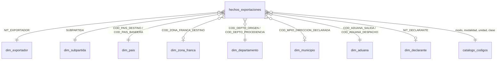

# BD única depurada: qué se limpió y qué quedó

El paso 9 del pipeline (`pipeline/p09_bd_depurada.py`) toma los productos del paso 7 y los convierte en **una sola base de datos consistente**, con un modelo estrella (una tabla de hechos y sus dimensiones), lista para analizar. Cubre enero de 2024 a septiembre de 2026.

- **Tabla de hechos:** 3.613.237 líneas de declaración, por USD 142.059,8 M FOB.
- **Directorio:** 13.305 empresas. De ellas, 3.195 son exportadores antioqueños: 2.875 con vínculo A y 320 con vínculo B.
- **Validación:** el FOB de cada trimestre es igual a la cifra oficial de MinCIT. El FOB agrícola nacional es igual al de MinAgricultura.

El detalle de cada regla, con las filas y el FOB que afectó, está en `docs/log_bd_depurada.csv` y dentro de la base, en la tabla `log_depuracion`. Cada columna está descrita en `docs/diccionario_bd_depurada.csv`.

## 1. Cómo obtenerla

El archivo DuckDB pesa unos 340 MB. GitHub no acepta archivos de más de 100 MB, así que no se versiona. Lo que sí está en el repositorio son sus tablas en parquet, en `data/processed/bd_depurada/`. Para armar la base en un solo archivo:

```bash
pip install -r requirements.txt
python crear_bd_depurada.py        # ~1 minuto → data/processed/bd_depurada/BD_exportaciones_Colombia_depurada.duckdb
```

Para regenerarla desde los productos del paso 7, por ejemplo cuando la DIAN publique un mes nuevo: `python run_pipeline.py --solo 9`.

```python
import duckdb
con = duckdb.connect("data/processed/bd_depurada/BD_exportaciones_Colombia_depurada.duckdb", read_only=True)

# Diez principales destinos de los exportadores antioqueños en 2025, sin contar envíos a zonas francas
con.sql("""SELECT PAIS_DESTINO, round(sum(VALOR_FOB_USD)/1e6, 1) AS fob_musd
           FROM vw_exportaciones
           WHERE ES_EXPORTADOR_ANTIOQUENO AND ANIO = 2025 AND NOT ES_DESTINO_ZONA_FRANCA
           GROUP BY 1 ORDER BY 2 DESC LIMIT 10""").show()

directorio = con.sql("SELECT * FROM vw_directorio_antioquia").df()
```

Sin DuckDB también se puede leer con pandas: `pd.read_parquet("data/processed/bd_depurada/hechos_exportaciones/")`.

## 2. Qué contiene



| Objeto | Qué es | Filas |
|---|---|---|
| `hechos_exportaciones` | Una fila por serie (ítem) de declaración DIAN, depurada. 63 columnas | 3.613.237 |
| `dim_exportador` | Directorio por NIT: RUES, Supersociedades, SECOP II, vínculo con Antioquia y cifras recalculadas | 13.305 |
| `dim_subpartida` | Subpartida a 10 dígitos, capítulo, partida, SA6, sector y producto agrícola | 5.881 |
| `dim_pais` | País destino y país de bandera con ISO 3166 alfa-3 | 215 |
| `dim_zona_franca` | Zonas francas colombianas que aparecen como destino | 31 |
| `dim_departamento`, `dim_municipio` | DIVIPOLA | 34 y 93 |
| `dim_aduana`, `dim_declarante` | Aduanas y agencias de aduanas | 22 y 717 |
| `catalogo_codigos` | Modo de transporte, modalidad, unidad física, clase de exportador y tipo de identificación | 31 |
| `vw_exportaciones` | **Empezar aquí:** los hechos con todos los nombres y atributos | 3.613.237 |
| `vw_exportaciones_antioquia` | Mercancía de origen Antioquia o de exportadores antioqueños; equivale a `exportaciones_antioquia/` | 1.034.865 |
| `vw_directorio_antioquia` | Exportadores antioqueños (A y B) por ranking | 3.195 |
| `vw_serie_mensual` | FOB y número de exportadores por mes | 33 |
| `vw_validacion_mincit`, `vw_validacion_madr` | Cuadre contra cifras oficiales | — |
| `log_depuracion`, `diccionario_datos`, `info_bd` | Reglas aplicadas, diccionario y metadatos | — |

## 3. Proceso de limpieza

| # | Problema encontrado | Regla aplicada | Impacto |
|---|---|---|---|
| 1 | Información repetida: `exportaciones_antioquia/` es un subconjunto exacto de `exportaciones_nacional/`, y cada línea repetía 12 columnas del directorio | Una sola tabla de hechos. Lo de Antioquia queda como vista y los atributos de la empresa en `dim_exportador` | 1.034.865 líneas que ya no se guardan dos veces |
| 2 | En el archivo DIAN de **septiembre de 2024** la razón social de las empresas viene como "PERSONA NATURAL" o vacía, aunque la línea trae el NIT | Persona natural es la que **no tiene NIT** publicado; no se decide por la razón social. Esas líneas se atribuyen a la empresa y se marcan con `FLAG_RAZON_SOCIAL_ENMASCARADA` | 107.212 líneas de 3.927 NIT, USD 4.102,4 M |
| 3 | El NIT viene con ceros a la izquierda y el de las personas naturales como "0" o vacío | NIT sin ceros a la izquierda; NULL para personas naturales (`ES_PERSONA_NATURAL`) | 16.714 líneas de personas naturales, USD 247,6 M |
| 4 | `PAIS_DESTINO_NORM` ponía **"ZFP de Rionegro S.A." a las 31 zonas francas** del país, y 2 líneas de zona franca venían con el código de Puerto Rico | Código `XCF` para zona franca colombiana, bandera `ES_DESTINO_ZONA_FRANCA` y la zona franca real en `dim_zona_franca` | 38.520 líneas, USD 2.616,3 M. En 281 empresas cambia el top 3 de destinos |
| 5 | La DIAN cambió en 2025 la codificación de países y banderas: en 2024 usa ISO alfa-2, códigos numéricos propios y nombres en MAYÚSCULA; desde 2025, alfa-3, M49 y nombres en tipo oración | Un solo código ISO alfa-3 y un solo nombre por país (`dim_pais`). Se retiran las 7 columnas de país y bandera de la fuente | 1.302.673 líneas de 2024 homologadas |
| 6 | Errores de digitación de la fuente | "Correción" → "Corrección", "despúes" → "después", "Unico" → "Único" | 1.030.911 líneas (más "Único" en todas) |
| 7 | Espacios dobles, tabulaciones, comillas sobrantes y entidades HTML ("&#304STANBUL") | Textos limpios y entidades decodificadas ("İSTANBUL") | 3.574.240 líneas con al menos un texto corregido |
| 8 | Códigos escritos de dos formas ("2" y "002") | Modalidad a 3 dígitos, aduana y departamento a 2, subpartida a 10 con su cero inicial | 24.736 líneas en modalidad |
| 9 | Ceros que significan "no aplica" (formulario, declaración anterior y precedente, NIT declarante) | Pasan a NULL | Afecta casi todas las líneas. Las 1.690 sin número de formulario (hidrocarburos) se conservan: suman cerca del 25 % del FOB |
| 10 | Fechas guardadas como texto (AAAAMMDD, AAAAMM) | Pasan a tipo fecha | — |
| 11 | Departamentos con varias grafías ("BOGOTA DC", "BOGOTÁ, D.C.") | Código DIVIPOLA y nombre oficial (`dim_departamento`) | — |
| 12 | Columnas redundantes o vacías | Se retiran de la tabla de hechos: `FECHA_PROCESO` (= `PERIODO`), `TIPO_DECLARACION` (= `TIPO_DESPACHO`), códigos que repiten su descripción, `COD_USUARIO` (99,97 % vacío), `COD_LUGAR_SALIDA_NUM` (no es 1:1 con el lugar) y nombres que ahora viven en dimensiones | De 99 a 63 columnas, sin perder información |
| 13 | Una empresa con varias razones sociales (por ejemplo "ECOPETROL S A" y "ECOPETROL S.A.") | Una razón social canónica, la más reciente de la DIAN; si nunca se publicó, la del RUES. Las variantes quedan en `NOMBRES_EN_FUENTE` | 332 NIT con varios nombres; 119 toman el nombre del RUES y 1 queda sin nombre |
| 14 | Atributos externos en formatos distintos (CIIU "610" y "4620.00", fechas como texto) | CIIU a 4 dígitos, fechas, booleanos y números con su tipo | — |

### Decisiones que conviene conocer

- **Filas idénticas:** hay 10 líneas idénticas en todo a otra (USD 39,6 M). Todas son de las que no tienen número de formulario, así que la DIAN no deja forma de distinguir los envíos. Se evaluó eliminarlas, pero con ellas el FOB trimestral cuadra con MinCIT y sin ellas 2025-T1 queda 0,28 % por debajo (un embarque de crudo de USD 33 M). Por eso **se conservan** y se marcan con `FLAG_REGISTRO_IDENTICO`. Para excluirlas: `WHERE NOT FLAG_REGISTRO_IDENTICO`.
- **Zonas francas:** una exportación a zona franca no sale del país. Para analizar solo ventas al exterior, filtra con `NOT ES_DESTINO_ZONA_FRANCA`.
- **Domicilio:** la dirección declarada a la DIAN suele ser la de la agencia de aduanas. El vínculo con Antioquia sale del RUES, con la misma regla de `docs/metodologia.md`.
- **Directorio:** se recalcula desde la tabla de hechos depurada. Frente al directorio del paso 7 no cambia ningún FOB ni ningún `VINCULO_ANTIOQUIA`; cambian los textos derivados del país (top 3 de destinos) por la corrección de zonas francas.

### Revisiones sin hallazgos

FOB menor o igual a cero, peso neto mayor que el bruto, fechas inválidas, tasa de cambio implícita (FOB COP / FOB USD) a más de ±20 % de la mediana del mes, y declaraciones corregidas que conviven con su original (doble conteo). Hay 33 líneas con peso en cero: se conservan y se marcan con `FLAG_PESO_CERO`.

## 4. Validación

| Comparación | Resultado |
|---|---|
| FOB total trimestral contra MinCIT (2024-T1 a 2026-T2) | Igual; la única diferencia es 0,01 % en 2026-T2 |
| FOB no minero-energético contra MinCIT | Diferencia entre 0,11 % y 0,20 % por trimestre |
| FOB agrícola nacional contra MinAgricultura | Igual (USD 11.477,5 M en 2024; 15.317,1 M en 2025) |
| FOB agrícola de origen Antioquia contra MinAgricultura | Diferencia entre 0,6 % y 1,0 % |
| Integridad referencial | Las 15 llaves de la tabla de hechos encuentran su dimensión; cero huérfanos |
| Unicidad | Cada llave de dimensión es única y `vw_exportaciones` tiene las mismas filas que la tabla de hechos |
| FOB del directorio | Suma de empresas + personas naturales = total nacional |

## 5. Equivalencia de columnas

Para pasar código que usaba los parquet del paso 7:

| Paso 7 (`exportaciones_nacional/`) | BD depurada |
|---|---|
| `NIT`, `NIT_EXPORTADOR` | `NIT_EXPORTADOR` (limpio) |
| `RAZON_SOCIAL_EXPORTADOR` | `RAZON_SOCIAL` en `dim_exportador` y en `vw_exportaciones` |
| `SUBPARTIDA`, `SUBPARTIDA_10D` | `SUBPARTIDA` |
| `PAIS_DESTINO_NORM`, `PAIS_DESTINO_FINAL`, `COD_PAIS_DESTINO*` | `COD_PAIS_DESTINO` y `PAIS_DESTINO` (vista) |
| `BANDERA`, `COD_NACIONALIDAD_BANDERA`, `NACIONALIDAD_BANDERA` | `COD_PAIS_BANDERA` y `PAIS_BANDERA` (vista) |
| `COD_REGION_ORIGEN`, `REGION_DE_ORIGEN` | `COD_DEPTO_ORIGEN` y `DEPTO_ORIGEN` (vista) |
| `COD_REGION_PROCEDENCIA`, `REGION_PROCEDENCIA` | `COD_DEPTO_PROCEDENCIA` y `DEPTO_PROCEDENCIA` (vista) |
| `ADUANA_SALIDA`, `ADUANA_DESPACHO`, `MODO_TRANSPORTE`, `MODALIDAD_EXPORTACION`, `UNIDAD_FISICA` | Su código en hechos y su nombre en la vista |
| `FECHA_DECLARACION_EXPORTACION` (texto) | `FECHA_DECLARACION` (fecha) |
| `VALOR_FOB_PESOS`, `VLR_SERIE_*` | `VALOR_FOB_COP`, `VALOR_AGREGADO_NACIONAL_USD`, `VALOR_FLETES_USD`, `VALOR_SEGUROS_USD`, `VALOR_OTROS_GASTOS_USD` |
| `TIPO_DE_DATOS`, `TIPO_DE_EMBARQUE` | `TIPO_DATOS`, `TIPO_EMBARQUE` |
| `DIREC_EXPORTADOR` | `DIRECCION_DECLARADA` |
| `NUM_SOLICITUD_AUTO_EMBARQUE`, `FECHA_SOLICITUD_AUTO_EMBARQUE` | `NUM_AUTORIZACION_EMBARQUE`, `PERIODO_AUTORIZACION_EMBARQUE` |
| `NUM__DECLA_EXPORTACION_ANT`, `FECH_DECLA_EXPORTACION_ANT` | `NUM_DECLARACION_ANTERIOR`, `PERIODO_DECLARACION_ANTERIOR` |
| `RAZON_SOCIAL_ENMASCARADA` | `FLAG_RAZON_SOCIAL_ENMASCARADA` |
| `SECTOR_EXPORTACION`, `ES_MINERO_ENERGETICO`, `ES_AGRICOLA_MADR`, `PRODUCTO_AGRICOLA_MADR` | En `dim_subpartida` y en la vista |
| `NIT_EMPRESA_ANTIOQUENA`, `NIT_ES_EXPORTADOR_ANTIOQUENO`, `NIT_VINCULO_ANTIOQUIA`, `NIT_*` | `EMPRESA_ANTIOQUENA`, `ES_EXPORTADOR_ANTIOQUENO`, `VINCULO_ANTIOQUIA` y demás en `dim_exportador` y en la vista |

## 6. Limitaciones

- Las personas naturales no tienen NIT publicado: están en los hechos, pero no en el directorio.
- La ciudad del destinatario es texto libre y no se normaliza (aparecen "ISTANBUL" y "ESTANBUL").
- La base DIAN no trae la descripción de las subpartidas; solo las agrícolas la tienen, gracias a MinAgricultura.
- Algunos códigos DIAN (tipo de usuario, oficina, forma de pago, régimen CAN, certificado de origen) no tienen descripción en la fuente.
- El año en curso está incompleto: `info_bd` dice hasta qué mes llega.
